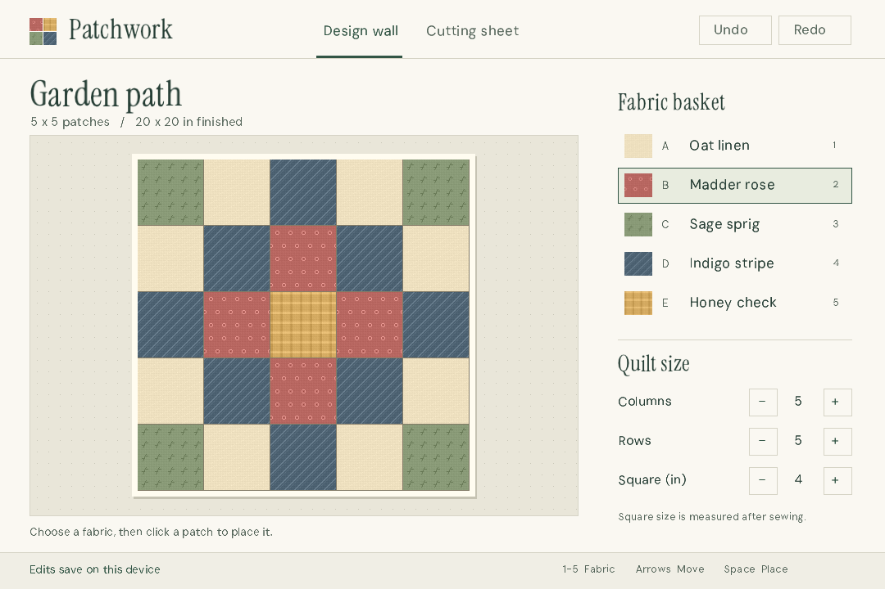
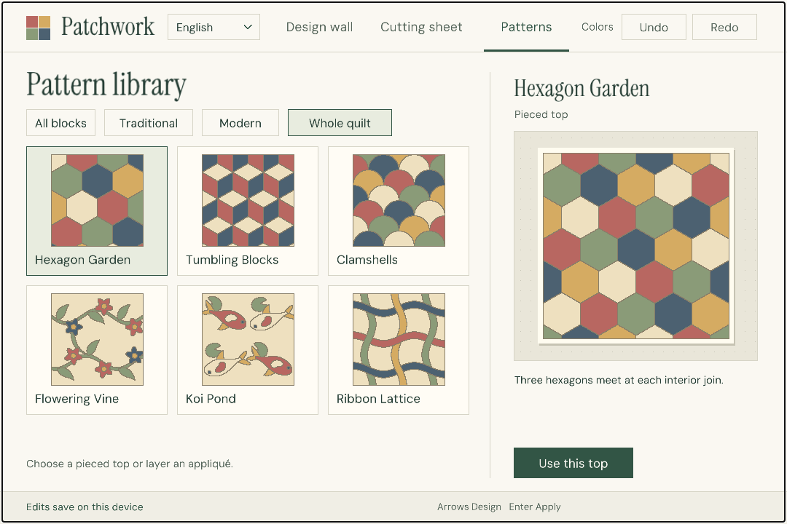

# Patchwork

A design wall for a home quilter. Start with the five fabrics in the basket, add your own scraps, and try a design on screen before cutting your fabric.

[Open the quilt planner in your browser](https://stbange.github.io/patchwork/)



## Plan a quilt

1. Open **Patterns** for 39 block designs, 312 block arrangements and six whole-quilt designs. Try the linked diamonds in **Storm at Sea** or the strips in **Braided Ribbons**. Use **Fill quilt** for the full preview or **Place block** to put that motif into individual positions. Pick another motif to build a mixed quilt.
2. On the design wall, choose straight seams, staggered rows or staggered columns. Choose **cm** or **in** and click the size to enter an exact measurement. For block quilts, the size describes the base block before staggering. For whole-quilt designs, it scales the repeat and the finished top. The cutting sheet calculates the width and height of each piece.
3. Choose **+ Fabric** in the basket or under **Colors** to add a sixth fabric. Set its color with the sliders or enter a hex value. The basket holds 26 fabrics, A through Z. Use its arrows to browse five at a time. The 100 named palettes recolor A through E and keep the colors of additional scraps.
4. Open **Cutting sheet** for quantities and a row map. **Download PDF** on the web or **Save PDF** on desktop gives you the colored quilt map and cutting instructions. The text sheet gives the same quantities and template measurements. Pieced shapes include a 1/4 inch (0.635 cm) seam allowance. Raw-edge appliqué is cut on its outline.

English, German and Polish are available from the language menu next to the logo. The planner uses your device's preferred supported language on the first launch. Language and unit preferences are saved on the device.

**Deutsch** Im Sprachmenü **Deutsch** wählen. Über **Muster**, **Farben** und **Zuschnittplan** lassen sich Blöcke kombinieren, Stofffarben ändern und der Plan als PDF speichern.

**Polski** W menu języka wybierz **Polski**. Karty **Wzory**, **Kolory** i **Plan cięcia** pozwalają łączyć bloki, zmieniać kolory tkanin i zapisywać plan jako PDF.

## Design across seams

Open **Patterns → Whole quilt**. **Hexagon Garden** joins three hexagons at each interior corner. **Tumbling Blocks** builds cubes from three diamonds. In **Clamshells**, the lower curves of one shell nest into two shells in the next row. Choose **Use this top**, select a fabric and click anywhere inside one piece to recolor it.



To add appliqué, choose **Flowering Vine**, **Koi Pond** or **Ribbon Lattice**. **Add to my quilt** lays the design across your current piecing. **On plain cloth** gives it a single fabric background. A quilt can carry one appliqué design at a time. Each leaf, blossom and koi marking takes its own fabric. Painting a ribbon changes it along its entire path through the weave. **Edit background** lets you reach a piece under an appliqué.

The PDF includes a colored map and full-size A4 tracing pages for the whole-quilt designs. Print at **100%**, measure the scale bar, trim to the frames and join the numbered tiles. For piecing, sew on the solid line and cut on the dashed line. For raw-edge appliqué, cut on the solid outline. The piece numbers match the fabric list. **Remove appliqué** lifts the design from the top, and **Restore blocks** brings back the saved block layout.

## Try a table topper

1. Open **Patchwork**. The Garden Path sample has five rows and five columns. Each square measures 4 inches after sewing.
2. Choose **Madder rose** and click the honey-colored center. Try **Undo** and **Redo** to compare the two designs. Add a row or column if you want a larger piece.
3. Open **Cutting sheet**. For the original 20 × 20 inch topper, cut 25 squares at **4½ × 4½ inches**. The extra half inch leaves a quarter-inch seam at both edges of each dimension. Each fabric has a letter and a quantity. The row map shows where each piece goes.
4. Save or download the PDF to take the map and cutting instructions to the sewing table. Edits save automatically. Reopen the app in the same browser or desktop account to pick up where you left off.

The planner covers straight and curved piecing and raw-edge appliqué for the quilt top. Backing, batting and binding are separate materials. The design wall and cutting sheet use OpenGL on Windows and Linux and WebGL in the browser. The concept also describes an optional 3D table preview and a first sewing session to try with the quilter. [OpenSpec design](openspec/changes/archive/2026-11-22-add-quilt-design-wall/design.md)

## Run it

GitHub Pages publishes the browser version after the Linux, Windows and web tests pass on `main`. For an offline copy, download the matching artifact from a successful [build on main](https://github.com/stbange/patchwork/actions/workflows/check.yml?query=branch%3Amain).

| Platform | Open the planner |
| --- | --- |
| Windows x64 | Unzip the artifact, keep the `assets` folder beside `patchwork.exe`, and open the executable. |
| Linux x64 | Unzip the artifact, extract the tarball, and run `./patchwork` beside its `assets` folder. The binary is built on Ubuntu 24.04. |
| Web (offline) | Unzip the artifact and open `index.html` in a desktop browser. The HTML includes the application and fonts. |

The desktop app keeps the current quilt in SDL's per-user preference directory under `Patchwork/Planner/quilt.pw`. Launch `patchwork --project path/to/topper.pw` to work in a particular file. The browser saves in local storage. Existing square, patterned and mixed-block plans open in the updated app. A damaged plan is preserved and the status bar reports the problem. On desktop, a fresh project path lets you keep working.

SDL3 chooses desktop OpenGL first, then OpenGL ES where available. The Emscripten build uses SDL's OpenGL ES 2 renderer on a WebGL canvas. Both can fall back to software rendering when GL is unavailable. The startup log reports the selected backend. On desktop, setting `SDL_RENDER_DRIVER=software` explicitly selects software rendering.

| Keyboard | Action |
| --- | --- |
| 1 through 5 | Select one of the five visible fabrics |
| N, then Enter | Add a fabric and apply its color |
| Comma or period | Browse the fabric basket or cutting-sheet fabric list |
| W | Switch between painting the visible layers and the background |
| Arrow keys, [ or ], then Space | Move to a block, select a piece, and place the fabric |
| C or R, with Shift to decrease | Change columns or rows |
| + or − | Change the finished block size |
| P | Open or close Patterns |
| 1 through 3 in Patterns | Show all, traditional, or modern designs |
| 4 in Patterns | Browse whole-quilt designs. Enter applies to the current top. B puts an appliqué on plain cloth. X removes appliqué and G restores blocks. |
| Arrow keys, Page Up or Page Down in Patterns | Browse designs |
| [ or ], then Enter in Patterns | Choose a setting and fill the quilt |
| B in Patterns | Pick the motif for individual blocks. Use brackets to turn it before placing and Esc to finish. |
| F | Open or close Colors |
| L, then 1 through 3 | Choose English, German, or Polish |
| U | Switch inches and centimetres |
| M | Enter a finished block size |
| Ctrl+Z, Ctrl+Y or Ctrl+Shift+Z | Undo or redo |
| Tab, then D on the cutting sheet | Open the cutting sheet and save the PDF |
| S | Retry saving after a storage error |

## Build and test

Use CMake 3.24 or newer and a C11 compiler. The build uses an installed SDL 3.2+ or fetches pinned SDL 3.2.28 sources. It also fetches a hash-checked stb_truetype header. The two open fonts and their licenses are in `assets/`. On Linux, install the X11 development packages listed in the workflow if building SDL from source.

```sh
cmake -S . -B build -DCMAKE_BUILD_TYPE=Release
cmake --build build --config Release
ctest --test-dir build -C Release --output-on-failure
```

On Windows use Visual Studio 2022 or later. Single-configuration generators place the executable in `build/app/`. Visual Studio adds the configuration directory, such as `build/app/Release/`.

With the Emscripten 4.0.15 SDK active, build the self-contained browser file with these commands.

```sh
emcmake cmake -S . -B build-web -DCMAKE_BUILD_TYPE=Release -DBUILD_TESTING=OFF
cmake --build build-web
```

For a fresh coverage run, use GCC and gcovr. Run the coverage command immediately after the unit suite, before launching the application or its end-to-end tests in that build. The gate counts executable lines of the project's C code in the native build. The SDL entry-point header, third-party code and test sources contribute no lines to the denominator. Browser-specific storage and download code is exercised in Chromium.

```sh
cmake -S . -B build-coverage -G Ninja -DPATCHWORK_COVERAGE=ON
cmake --build build-coverage
ctest --test-dir build-coverage --output-on-failure
gcovr --root . --filter '^src/' --txt --fail-under-line 95 build-coverage/CMakeFiles/workroom.dir
```

The unit suite checks every block, the area and tessellation of the new foundations, curved rendering, alternating ribbon crossings, and all four plan formats. It also verifies that the 312 block layouts and 100 palettes are distinct. The desktop journey checks OpenGL, saving, and the system clipboard. Linux uses Xvfb with GLX, xdotool and xclip and verifies native PDF saving. Windows uses Win32 window messages and Mesa for OpenGL. The browser journey paints one clamshell across a former block boundary, follows a sixth fabric through woven crossings, reopens the quilt and inspects the English and Polish tracing PDFs with both WebGL and software rendering. Install Poppler to check the downloaded PDF's text in the browser tests.

```sh
xvfb-run -a -s '-screen 0 1440x940x24 -noreset' python3 tests/desktop_e2e.py build/app/patchwork
# Windows: python tests/desktop_e2e.py build/app/Release/patchwork.exe
python -m pip install playwright==1.62.0
python -m playwright install chromium
python tests/web_e2e.py build-web/app
npx --yes @fission-ai/openspec@2.1.1 validate --all --strict
```

One C quilt model drives the design wall, cutting sheet and pattern library. [Quilt-planning specification](openspec/specs/quilt-planning/spec.md) · [Localization specification](openspec/specs/planner-localization/spec.md) · [Expanded planner change](openspec/changes/archive/2026-11-23-localize-and-expand-planner)
